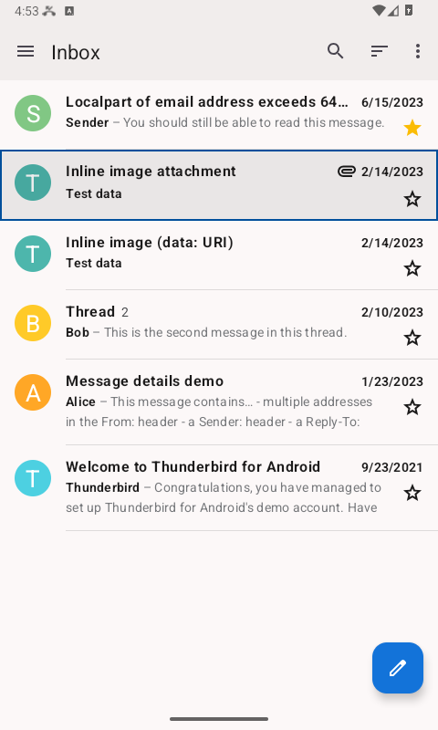
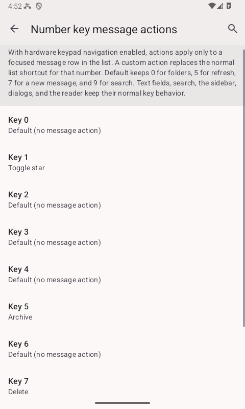

# Hardware keypad navigation

Hardware keypad navigation is an optional mode for Android phones with a directional pad and physical keys.
It is disabled by default. Enable it under **Settings → General settings → Interaction → Hardware keypad navigation**.
On the initial setup screen, press **Left soft key / F1**, select **Enable hardware keypad navigation**, and
press **Center / Enter**. Opening this menu alone does not enable the mode.

The keypad changes use Android APIs available on Android 8.0 (API 26) and newer. They do not require root
or accessibility-service permissions. Device firmware must deliver the keys to the app.

## Navigation and menus

| Key | Action when the mode is enabled |
| --- | --- |
| Directional pad | Move focus using the screen's normal Android navigation |
| Center / Enter | Activate the focused control, or use the text editor's normal Enter behavior |
| Left soft key / F1 | Open the current screen's actions as a keypad menu |
| Right soft key / F2 | Hide the on-screen keyboard first when it is visible; otherwise go back |
| `*` outside a text editor | Move to the previous control (Shift+Tab) |
| `#` outside a text editor | Move to the next control (Tab) |

In a text editor, digits, `*`, and `#` remain available to the input method. The numeric shortcuts below apply
outside text editors, with no search field, folder drawer, or dialog covering the content. Modified keys such
as Ctrl+F1 retain their normal behavior. Backspace does not invoke the delete-message shortcut in this mode.

Use the directional pad and Center / Enter to choose a menu action. F2 returns from a submenu or closes the
menu. Screens without an actions menu offer **Next control**, **Previous control**, and **Back** instead.

## Message list

| Key | Action |
| --- | --- |
| Up / Down | Focus a message row |
| Center / Enter | Open the focused message, or toggle its selection if selection mode is already active |
| Left | Open the account and folder drawer |
| Right while the drawer is open | Close the drawer |
| `0` by default | Open the account and folder drawer |
| `5` by default | Refresh the message list |
| `7` by default | Compose a message |
| `9` by default | Focus and expand search |
| Left soft key / F1 | Open the list's current actions |

In keypad mode, the traditional message list gives keyboard focus to the complete row, with a visible outline.
Touching its avatar or star still performs the existing selection or star action. Closing the drawer restores
the same message by identity, even after reordering. If it has been removed, focus stays on the list container.
Other controls regain their previous focus when available. Right otherwise keeps its normal focus navigation.
The number-key defaults above apply when that key has no custom message action; see the dedicated settings
screen below.

Returning from the reader restores focus to the same message, including after its position changes.
If that message has been removed, focus stays on the list container until you navigate again. Other input,
leaving the screen, or turning keypad mode off cancels a pending restoration.



## Reading a message

The first completed body load focuses the message body once, preserving the restored scroll position.
It does not take focus back after you have begun navigating or editing another control.

| Key | Action |
| --- | --- |
| Up / Down while the body has focus | Scroll the message document; holding the key continues scrolling |
| `1` / Home navigation key | Scroll to the top of the document |
| `3` / End navigation key | Scroll to the bottom, including the attachment area |
| `2` / Page Up | Scroll up one page with overlap |
| `8` / Page Down | Scroll down one page with overlap |
| `4` / `6` while the body has focus | Pan left / right when HTML content is wider than the viewport |
| `5` | Focus the body; reveal it if it has scrolled off-screen |
| `7` | Focus the header's reply action, when available |
| `9` | Focus the attachment-list entry point, when attachments are available |

Press Center / Enter after `7` or `9` to activate the focused control. These shortcuts do not send a reply or
open an attachment automatically. A fresh Up / Down press at the document boundary can move focus out of the
body to nearby controls. On other buttons, arrows retain their normal focus behavior. Use `*` / `#` to move
between controls or HTML links, and F2 to return to the message list. The physical system Home key is unchanged;
the table's Home navigation key means a keyboard's `MOVE_HOME` event.

Scrolling uses the outer message document for both plain text and HTML bodies. Page overlap and line steps
account for the viewport and system font size. Horizontal panning is available only when the HTML body can
actually scroll horizontally; a message fitted to the screen may not need it.

## Composing a message

F1 opens the composer's actual actions menu, including its existing send, save, and attachment actions.
The following keypad actions appear first:

| Menu action | Result |
| --- | --- |
| Next field / Previous field | Move between text fields without inserting a tab or taking digits from the input method |
| Message body | Focus and reveal the message editor |
| Attachments | Focus the first attachment's remove control; available when attachments exist |

Field navigation preserves the editor's cursor or selection. Removing an attachment restores focus to the
next attachment, the previous attachment, or the message body. Sending, saving a draft, and discarding changes
retain their existing confirmation behavior.

## Dialogs and choice lists

Thunderbird's confirmation dialogs, choice lists, compose dialogs, and keypad menus use their own window
mappings. They never activate shortcuts on the screen behind the dialog.

| Key | Action in the dialog |
| --- | --- |
| Left soft key / F1 | Move to the next control, including leaving a text field |
| Right soft key / F2 | Hide the on-screen keyboard first; otherwise use the dialog's normal Back behavior |
| `*` / `#` outside a text editor | Move to the previous / next control |
| Directional pad and Center / Enter | Navigate and activate choices using the dialog's normal behavior |

`*` and `#` inside a text editor still belong to the input method. F1 provides a way to leave that editor
without using those characters as navigation keys.

## Number key message actions

Open **Settings → General settings → Interaction → Number key message actions** to configure each key
from **0** through **9** independently. Each key offers **Default (no message action)**, **Delete**,
**Archive**, and **Toggle star**. Every key initially uses **Default**, preserving its normal list shortcut.

For example, set **Key 1** to **Archive** and **Key 3** to **Toggle star**. Those keys then act on the message
row with keyboard focus. Binding a number replaces its original list shortcut: binding **Key 5** to
**Delete** replaces refresh with delete. Restore **Default** to use refresh again. The unbound defaults are
`0` for folders, `5` for refresh, `7` for a new message, and `9` for search. Left still opens the folder
drawer even if `0` has been assigned a message action.

Custom actions apply only while keypad mode is enabled and a message row in the foreground message list
has keyboard focus. They do not act on a previously focused message, an open message, a multiple selection,
or content behind a search field, folder drawer, or dialog. A configured number never falls back to its
original list shortcut when there is no eligible message row. Returning from the reader restores the exact
row before it becomes an action target; a removed message never redirects an action to a neighboring row.
Delete retains the existing delete-confirmation setting.

A complete press performs the configured action once. Moving focus, leaving the list, or changing the
setting during the press cancels that action. Text fields and search keep digits available to the input
method. Menus, folders, and dialogs retain their normal key behavior. The reader keeps its number-key
navigation, including `4` and `6` to pan wide message bodies, regardless of the configured list actions.

Call and end-call keys keep their system behavior. This mode does not intercept them. Home and Power
behavior is unchanged.



## Scope

The mappings cover Thunderbird activity and dialog windows, including its keypad menus.
System file pickers, external browsers or sign-in applications, and external
attachment viewers keep their own key handling. The mode does not replace an input method or add predictive
text entry. It does not require changing system key layouts, the default dialer, Home, or Power behavior.

## Source patch and test builds

This is an application source change, not an installable add-on for an existing Thunderbird APK.
A source patch can be applied to the documented base revision and rebuilt. A debug test build uses the
separate `net.thunderbird.android.debug` application ID and can be installed alongside the official app.
It has its own account data; installing it does not migrate accounts automatically.

For a source checkout containing the patch:

```shell
./gradlew :app-thunderbird:assembleFossDebug
```

The upstream minimum Android version is unchanged. Supporting Android 8 and newer does not imply that
every manufacturer key layout, authentication flow, attachment viewer, or embedded HTML control has been tested.
