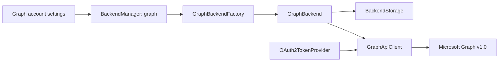

# Graph API integration design

The Graph provider is a separate backend type, not an IMAP impersonation. `backend/graph` contains the REST client and a `Backend` adapter; `BackendManager` routes the distinct `graph` type through `GraphBackendFactory`. Existing IMAP and POP factories, protocol settings, and their OAuth scopes are left as they were.

## Synchronization

For Graph account creation, the per-folder message count defaults to 10; the existing defaults for IMAP, POP, and other account types are unchanged, and any count selected by the user is preserved. The first sync requests the number of newest messages selected in account setup (the folder's `visibleLimit`), ordered by `receivedDateTime desc`; it falls back to the sync configuration's positive default only if the folder limit is unset or non-positive. The same bound is applied when choosing messages to download after the delta checkpoint. The checkpoint uses Graph's supported `receivedDateTime ge` filter beginning at the oldest message in that initial window and follows every opaque `@odata.nextLink` until it receives `@odata.deltaLink`. Any additional IDs returned during that bootstrap are kept as pending IDs and fetched on the next ordinary refresh, preventing arrivals during the initial list/checkpoint race from being skipped.

The initial list's `@odata.nextLink` is kept separately as the older-message cursor. Thunderbird's existing “Fetch more” action increases the folder's visible limit by the account display count; the Graph backend fetches that many additional messages, following as many opaque `@odata.nextLink` pages as needed. If the last page contains more IDs than the requested increment, the unconsumed IDs are retained in a per-folder queue so no results are skipped while the continuation URL remains untouched. Ordinary refreshes use the saved delta link, follow all pages without a message-count cap, apply removals and read/flag changes, and store the new delta link only after processing completes. Graph documents support for `$select`, `$top`, the received-date filter and descending received-date order in [message delta](https://learn.microsoft.com/en-us/graph/api/message-delta?view=graph-rest-1.0); its [paging guidance](https://learn.microsoft.com/en-us/graph/paging) says to use the full `@odata.nextLink` URL.

Folder-specific cursors are stored through Thunderbird's existing backend-folder extras (`graphDeltaLink`, `graphOlderMessagesLink`, `graphVisibleLimit`, and `graphPendingMessageIds`). Graph folder IDs remain opaque server IDs. Folder hierarchy is traversed recursively, and well-known folder IDs are resolved separately so special-folder roles do not depend on localized names; Graph documents these locale-independent names in [mailFolder resource type](https://learn.microsoft.com/en-us/graph/api/resources/mailfolder?view=graph-rest-1.0).

## Message and attachment data

Message bodies and envelope fields are converted into Thunderbird's existing MIME message representation. For messages with attachments, the sync path selects common attachment metadata only; it does not request `contentBytes`. Since `contentId` is specific to `fileAttachment`, inline file attachments get a separate typed-resource metadata request selecting only `id` and `contentId`. The MIME part stores the same provider-specific opaque attachment reference in both its Graph header and `serverExtra`, which is the local part-row lookup key used again when `fetchPart()` persists the downloaded body. `fetchPart()` retrieves the requested file or item bytes via Graph's `/$value` endpoint. Metadata size is retained for display but is not used to reject raw content; when the HTTP response supplies a `Content-Length`, the streamed byte count is checked against it and a mismatch discards the temporary body. Actual transport/read failures propagate normally. Microsoft's [attachment API documentation](https://learn.microsoft.com/en-us/graph/api/attachment-get?view=graph-rest-1.0) documents attachment property and raw-content retrieval. Reference attachments are not treated as downloadable file bytes.

Continuation URLs are accepted only when they remain on the configured Graph origin and v1.0 path. Requests use the injected OAuth token provider, refresh once after a 401, and never log access tokens. HTTP 429/503 responses retain their `Retry-After` value in the Graph exception for the caller; Graph advises waiting for that interval rather than immediately retrying ([throttling guidance](https://learn.microsoft.com/en-us/graph/throttling)).

## Account operations

The Graph adapter enables Move and Copy with the documented per-message Graph actions, returns the destination message IDs to Thunderbird, and supports read/unread, follow-up flag, mark-all-read, and delete actions. These writes use Graph's delegated `Mail.ReadWrite` scope. Sending uses the MIME `sendMail` action, which requires the separate delegated `Mail.Send` scope and saves the message in Sent Items by default. Graph advertises `savesSentMessagesToServer`, so Thunderbird discards the temporary local Outbox copy rather than enqueueing a duplicate `PendingAppend`; the controller also queues append only for backends that support upload. See Microsoft's [message move](https://learn.microsoft.com/en-us/graph/api/message-move?view=graph-rest-1.0), [message copy](https://learn.microsoft.com/en-us/graph/api/message-copy?view=graph-rest-1.0), [message update](https://learn.microsoft.com/en-us/graph/api/message-update?view=graph-rest-1.0), and [sendMail](https://learn.microsoft.com/en-us/graph/api/user-sendmail?view=graph-rest-1.0) references.

Send uploads use a longer write timeout. If a transport I/O error occurs without an HTTP response, Graph acceptance cannot be determined. The backend raises a permanent send error so Thunderbird leaves the message in the Outbox instead of automatically retrying and potentially duplicating a message; the error instructs the user to check Sent Items before choosing to retry. This does not claim the remote send failed or succeeded.

The backend remains polling-only and does not advertise push or expunge support. Uploading arbitrary messages/drafts and server-side search remain unsupported. Graph account setup and its Microsoft app-registration permissions/consent still need maintainer verification before broad enablement; the existing IMAP/SMTP scopes are unchanged. No FairEmail OAuth client ID or redirect is used.

## Graph UI capability audit — 2026-10-08

Graph account setup uses the fixed `graph.microsoft.com` OAuth configuration; endpoint, password, username, and client-certificate inputs are not presented as editable Graph operations. OAuth success is stored in account setup state before Graph validation; Graph validation bypasses IMAP/POP/SMTP protocol validators, and successful incoming validation routes Graph accounts past SMTP setup. The Graph-only settings UI omits outgoing SMTP configuration, server-side search, unsupported message-age/download-size/expunge/push choices, and folder Push. Folder Push visibility uses the backend push capability; local folder visibility, sync/notification preferences, and other provider behavior remain unchanged. Folder subscriptions are already omitted by the Graph `supportsFolderSubscriptions=false` capability.

Message-list and detail actions that map to supported native Graph operations remain available: mark read/unread, follow-up flag, delete, move, copy, archive, spam-folder move, refresh, Fetch more, and send via MIME `sendMail`. Remote search and expunge remain capability-hidden. Reply/forward/edit-as-new use Thunderbird's local compose path; Graph sending remains `sendMail`. Draft save falls back to the local Drafts store when server upload is unsupported, so it is locally available but is not a Graph server-upload/synchronization feature. The reviewed folder-management menus contain no create/rename/delete/subscribe mutation controls, so no nonexistent actions were added.

Attachment metadata remains a narrow `$select` without `contentBytes`. Microsoft Graph's [list-attachments example](https://learn.microsoft.com/en-us/graph/api/message-list-attachments?view=graph-rest-1.0) includes `@odata.type` on each attachment response; the client parses this discriminator. The MIME adapter omits `referenceAttachment` parts so they cannot appear as empty, non-openable attachment rows; Microsoft's [attachment GET documentation](https://learn.microsoft.com/en-us/graph/api/attachment-get?view=graph-rest-1.0) states that `/$value` is available for file/item attachments and returns HTTP 405 for a reference attachment. File/item bodies stay lazy and are fetched only when requested. Regression tests lock the type parsing, reference omission, hidden Graph setup fields, OAuth-state persistence, settings visibility, and folder Push capability behavior.

## Microsoft account reauthorization

The explicit “Reauthorize Microsoft account” action is available only on an existing Graph account's Incoming Server settings screen when the OAuth client ID, authorization/token endpoints, redirect URI, and scopes are configured. A default-off resource gate is overridden only for Thunderbird `fullDebug`; other variants do not expose or route into the flow. IMAP, POP, other providers, setup, and account-name editing remain unchanged.

Reauthorization uses the existing account OAuth UI and does not update the account until sign-in succeeds. The returned ID token must have Microsoft's issuer (consistent with its tenant claim) and the configured client audience. When both tenant and object IDs are saved, both must match. If only partial identity claims are available, every saved identifier and an email claim must match; if the old token cannot be decoded, the account email must match exactly (case-insensitively). An unprovable or different identity is rejected rather than mixed with cached Graph mail. The persistence adapter compare-checks the prior serialized OAuth state and changes only the account's `oAuthState`; server/profile settings, local messages/folders, and Graph folder cursors are not migrated or cleared. Cancel, authentication, identity, and persistence failures leave the existing OAuth state in place.
